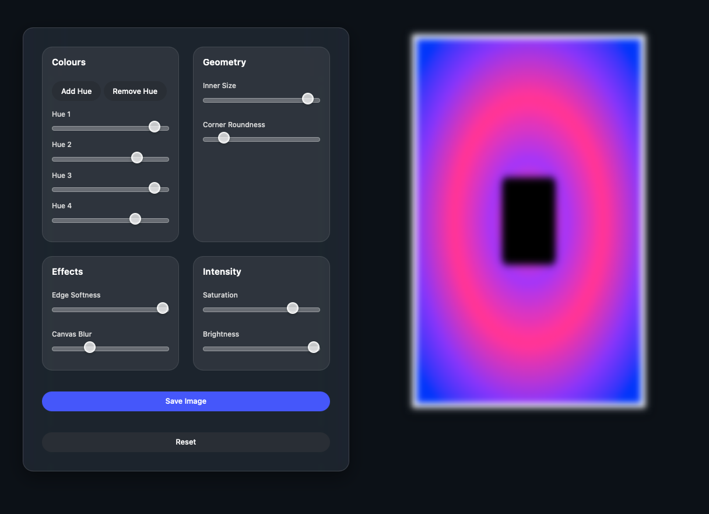

# Wallpaper Art Generator

A browser-based generative-art playground inspired by Nick Thomm. Adjust colors and shape controls in a Three.js/WebGL shader and export a vertical wallpaper.



## Run locally

```sh
git clone https://github.com/Neel-Sh/Art-Generator.git
cd Art-Generator
python3 -m http.server 4173 --bind 127.0.0.1
```

Open [localhost:4173](http://localhost:4173) in a WebGL-capable browser. Serve the folder over HTTP because `sketch.js` is an ES module. Three.js loads from jsDelivr, so startup requires network access to that CDN.

## Controls and source

- Tune hues, saturation, value, softness, and rounded shape parameters.
- Use the export control to save the generated wallpaper locally.
- `index.html` contains the interface, `style.css` its layout, and `sketch.js` the shader and export behavior.

There is no package installation, build pipeline, or server-side rendering. After editing, check slider behavior, resizing, and exported image dimensions in a browser. See [Contributing](CONTRIBUTING.md).

Created by [Neel Sharma](https://github.com/Neel-Sh). The repository does not include a standalone license file.
